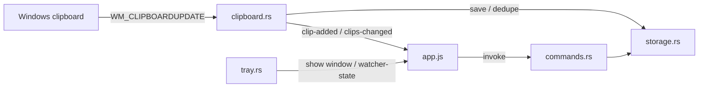

# Architecture

Clipt is a Windows desktop app: a Rust backend built on Tauri v2 and an HTML/CSS/vanilla-JS frontend rendered in WebView2. The backend owns everything stateful — the clipboard listener, SQLite history, media store, tray, and autostart — and the two halves communicate over Tauri IPC: the frontend calls commands, the backend pushes events. All data stays on the machine.

## Components

- `src-tauri/src/lib.rs` — wiring: plugins (single-instance, log, autostart), the startup sequence, window close-to-tray behavior, and IPC registration.
- `src-tauri/src/paths.rs` — every on-disk location; the app data root resolves to `%APPDATA%\Clipt\`.
- `src-tauri/src/settings.rs` — the `Settings` model, defaults, patch application, and the one-time `.env` import.
- `src-tauri/src/state.rs` — `AppState`, shared with all commands: the SQLite connection, settings, the pause flag, and the dedupe baseline.
- `src-tauri/src/storage.rs` — SQLite schema and all queries (`days`, `clips`, `pins`, `meta`); `storage/media.rs` is the content-addressed PNG store (sha256 filenames, garbage collection of unreferenced blobs); `storage/migrate.rs` imports history from the old Python version once.
- `src-tauri/src/clipboard.rs` — Win32 clipboard listener on a message-only window; reads, classifies, dedupes, and saves captures, and suppresses echoes of the app's own clipboard writes.
- `src-tauri/src/tray.rs` — tray icon and menu (show window, pause/resume); owns the pause state transition.
- `src-tauri/src/commands.rs` — the IPC command surface (see Interfaces below).
- `src/bridge.ts` — frontend entry: font imports, then loads `app.js`.
- `src/app.js` — the `CliptApp` class: rendering, modals, event subscriptions, all backend calls.
- `src/styles.css`, `index.html` — styling and the window shell.

## Key flows

**Startup** (`lib.rs` setup): ensure directories → open the SQLite DB (a corrupt file is quarantined aside, never fatal) → run the one-time legacy migration → load settings and apply the one-time `.env` import → apply launch-at-login → register shared state → build the tray → show the window unless launched with `--startup` → spawn the clipboard listener. Relaunching the app focuses the existing window (single-instance plugin); closing the window hides it to the tray.

**Capture**: a Win32 listener thread watches for `WM_CLIPBOARDUPDATE` → reads the clipboard with retries (files, image, or text) → classifies per capture settings (priority files > image > text; images over the size limit are skipped) → skips immediate repeats of the last saved clip → persists the clip (day row upserted; images saved as content-addressed blobs) → emits `clip-added` / `clips-changed` so the UI refreshes.

**Copy back / delete**: `copy_clip` writes to the system clipboard and records a fingerprint so the listener ignores its own write; `delete_clip` removes the row and deletes the blob once nothing else references it.

## Interfaces

IPC commands (`commands.rs`, registered in `lib.rs`):

- days: `get_days`, `get_day_data`, `update_day_label`
- search: `search_clips`
- pins: `get_pins`, `set_pin`, `remove_pin`
- clips: `delete_clip`, `copy_clip`
- settings: `get_settings`, `update_settings` (partial patch)
- watcher: `get_watcher_state`, `set_paused`
- app: `exit_app`

Events (backend → frontend): `clip-added`, `clips-changed`, `watcher-state`.

CLI: `--startup` (used by launch-at-login; starts without showing the window).

## Configuration and storage

Everything lives under `%APPDATA%\Clipt\`:

- `clipt.db` — SQLite: `days`, `clips`, `pins`, `meta`
- `media/` — cached clipboard images, content-addressed by sha256
- `settings.json` — user settings
- `logs/` — rotating log files (1 MB cap, 5 kept)
- `.env` — legacy import source for settings, read only once

The frontend loads only bundled files; the CSP allows `self` plus the local `asset:` protocol used to display images from `media/`.

## Platform

Windows-only by design: the app is built around the Win32 clipboard listener and tray; Win32-specific code is `#[cfg(windows)]`-guarded.

## Where to add code

- New IPC command → `commands.rs`, then register it in the `generate_handler!` list in `lib.rs`; call it from `app.js` via `invoke`.
- New persisted data → `storage.rs` (the schema is `CREATE TABLE IF NOT EXISTS`; there is no migration framework yet, so schema changes need explicit handling for existing databases).
- Capture behavior and dedupe policy → `clipboard.rs`.
- New setting → `settings.rs` (`Settings` struct, defaults, patch handling) plus the settings UI in `app.js`.
- UI changes → `app.js` and `styles.css`.
