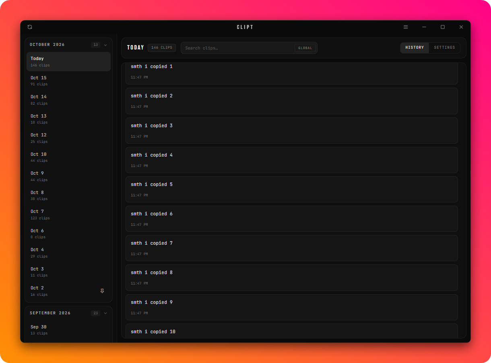

<div align="center">
  
<div id="toc">
  <ul style="list-style: none">
    <summary>
      <h1>Clipt</h1>
    </summary>
  </ul>
</div>

  <p><strong>Clipboard history manager for Windows</strong></p>

  <p>Records everything you copy — text, images, and files — into a searchable history organized by day, so you can find and re-copy anything later.</p>

  <p>
    
    
    
    
    
  </p>
</div>

[](https://github.com/noahain/Clipt/releases/latest)

---

Clipt lives in the system tray and keeps a searchable history of everything you copy — text, images, and files — organized by day. Pause capture any time from the tray, pin clips or whole days, and re-copy anything with one click. Everything stays on your machine, in `%APPDATA%\Clipt\`.

We built the backend with Tauri 2 and Rust — a native Win32 clipboard listener and SQLite storage — and the frontend with vanilla JavaScript, bundled by Vite. No Python, no runtime dependencies: one installer.

### Download

Grab a prebuilt installer from the [latest release](https://github.com/noahain/Clipt/releases/latest). No toolchain required.

**Which file?**

- **Windows**: `Clipt_*_x64-setup.exe` (NSIS) or `Clipt_*_x64_en-US.msi` to install. Either works — the `.exe` is the recommended default.

Ignore `.sig` files. The auto-updater uses those, and you don't need them for a manual download.

The app updates itself after that: it checks the release feed, verifies the minisign signature, and installs the new version on your confirmation.

### Build & Run

Ensure you have the Rust toolchain installed, then compile the application.

```bash
# Clone the repository
git clone https://github.com/noahain/Clipt.git
cd Clipt

# Install frontend dependencies
bun install

# Run in development mode
bun run tauri dev

# Build the release executable and installers
bun run tauri build
```

`bun run build` alone builds the frontend (tsc + Vite → `web-dist/`), which Tauri bundles. Backend checks run from `src-tauri/`: `cargo test` and `cargo clippy`.

### Features

- **Captures text, images, and copied files** — file entries store paths, not contents
- **Organized by day**, with editable day labels
- **Search** within the selected day or across all history
- **Pins** for clips and days, with an optional note
- **One-click copy** — paste any entry back to the clipboard
- **Tray controls** — open, pause, and resume; optional launch at login
- **Themes** — dark/light modes with background and surface-style options
- **Auto-updates** — signed release artifacts, verified before install
- **Imports history** from the original Python version of the app on first launch

### How it works

Clipt runs a native Win32 message-only window to watch for clipboard changes — event-driven, no polling — and writes each new clip to a single SQLite database (WAL mode) under `%APPDATA%\Clipt\`. Images are stored as content-addressed PNG blobs in `media/`; copied files are stored as path lists. The UI updates the same way: the backend emits events and the window refreshes without polling.

The frontend is plain JavaScript loaded through a small Vite bundle (`src/bridge.ts` → `src/app.js`) and talks to the backend with Tauri's `invoke` IPC. One command builds and runs everything: `bun run tauri dev`.

### Prerequisites

- **Rust toolchain** 1.85 or newer (edition 2024)
- **bun** for frontend tooling
- **Windows 10 or newer**; the installer fetches the WebView2 runtime if needed, and building from source requires [C++ Build Tools](https://learn.microsoft.com/en-us/cpp/build/vscpp-step-0-installation)

### Project Structure

<details>
<summary><b>View Directory Layout</b></summary>

```
Clipt/
├── src-tauri/                    # Rust backend
│   ├── src/
│   │   ├── main.rs               # Entry point
│   │   ├── lib.rs                # Tauri setup and plugin wiring
│   │   ├── clipboard.rs          # Win32 clipboard listener thread
│   │   ├── commands.rs           # IPC command handlers
│   │   ├── paths.rs              # %APPDATA%\Clipt\ path resolution
│   │   ├── settings.rs           # Settings model and persistence
│   │   ├── state.rs              # Shared state: database, settings, pause flag
│   │   ├── storage.rs            # SQLite schema and queries
│   │   ├── storage/
│   │   │   ├── media.rs          # Content-addressed image blob store
│   │   │   └── migrate.rs        # One-time import from the Python version
│   │   └── tray.rs               # Tray icon and menu
│   ├── capabilities/default.json # Permissions
│   ├── icons/                    # App icons (generated from assets/icon.png)
│   ├── Cargo.toml
│   └── tauri.conf.json
├── src/
│   ├── bridge.ts                 # Frontend entry (fonts, then app.js)
│   ├── app.js                    # Window UI
│   ├── updater.js                # Update check and toast flow
│   └── styles.css                # Application stylesheet
├── assets/
│   ├── icon.ico
│   ├── icon.png
│   └── screenshot-main.png
├── .github/workflows/release.yml # Build, sign, and release pipeline
├── index.html                    # Main window shell
├── ARCHITECTURE.md               # System architecture overview
├── CONTRIBUTING.md               # Build, style, and PR guide
├── CHANGELOG.md                  # Release history
└── SECURITY.md                   # Security reporting and app scope
```
</details>

### Configuration

Clipt stores everything under `%APPDATA%\Clipt\`:

| File / folder | Contents |
| ------------- | -------- |
| `clipt.db` | Clipboard history (SQLite, WAL mode) |
| `settings.json` | Application settings |
| `media/` | Content-addressed image blobs |
| `logs/` | Log files |

#### Key settings

| Parameter | Default | Description |
| --------- | ------- | ----------- |
| `capture.text` | `true` | Capture copied text |
| `capture.images` | `true` | Capture copied images |
| `capture.files` | `true` | Capture copied files (paths only) |
| `capture.maxImageBytes` | `26214400` | Largest image to capture (25 MB) |
| `theme.themeMode` | `dark` | `dark` or `light` |
| `theme.ctaStyle` | `blur` | `blur`, `glass`, `solid`, or `outline` |
| `theme.bgType` | `none` | `none`, `color`, or `gradient` |
| `theme.bgTransparency` | `75` | Background transparency (0–100) |
| `launchAtLogin` | `false` | Start Clipt when you sign in |

### Tech Stack

Rust • Tauri 2.12 • SQLite (rusqlite) • arboard • clipboard-win • image • Vite • vanilla JavaScript

### Contributing

Contributions are welcome. See [CONTRIBUTING.md](CONTRIBUTING.md) for build instructions and [ARCHITECTURE.md](ARCHITECTURE.md) for a tour of the codebase.

### Security & Updates

Clipt checks for updates through the Tauri updater and notifies you when one is available. Update artifacts are signed with a minisign key, and the app verifies that signature before installing.

As a clipboard history manager, Clipt reads your clipboard and stores it locally under `%APPDATA%\Clipt\`. Apart from the update check against GitHub Releases, the app makes no network requests. For the full picture and how to report a vulnerability, see [SECURITY.md](SECURITY.md).

### Credits

Tauri 2, rusqlite, arboard, clipboard-win, the `image` crate, and the Windows API bindings. UI fonts: Bebas Neue and JetBrains Mono (Fontsource).

### License

MIT
